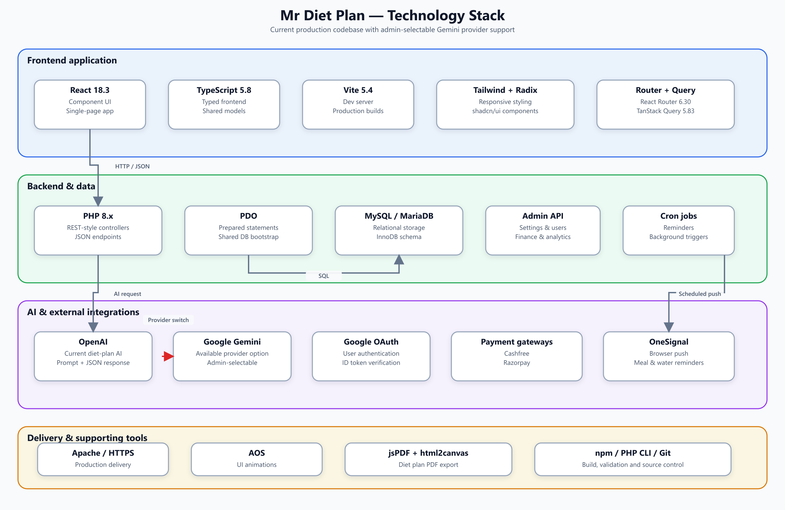

# MRDiet

MRDiet is a React and PHP web application for personalized diet plans, health tracking, subscriptions, referrals, payments, and administrative management.



## Main features

- Email/password and Google authentication
- Health profiles and personalized calorie targets
- AI-generated daily meal plans with OpenAI or Google Gemini
- Admin-selectable AI provider, model, and API keys
- Meal substitutions, daily check-ins, and period tracking
- Cashfree and Razorpay payments
- Coupons, referrals, withdrawals, and transaction administration
- OneSignal reminder notifications

## Local setup

1. Copy `api/config/config.example.php` to `api/config/config.php`.
2. Configure database and service credentials using environment variables or local values in the untracked `config.php`.
3. Create the `mrdietweb` database and import `api/schema.sql`.
4. Apply the SQL files under `api/migrations/`.
5. Start the backend from the repository root:

   ```powershell
   php -S 127.0.0.1:8000
   ```

6. Install and start the frontend:

   ```powershell
   cd frontend
   npm install
   npm run dev
   ```

The Vite application runs on port `8080` and proxies `/api` to the PHP server on port `8000`.

## AI provider configuration

Open **Admin → Settings → API Keys** to select OpenAI or Google Gemini. Configure the corresponding key and model, then save the settings. Both full plan generation and meal substitution use the selected provider.

## Architecture

- [Code architecture](docs/architecture-diagrams/code-architecture.png)
- [Runtime architecture](docs/architecture-diagrams/system-architecture.png)
- [Database ER diagram](docs/architecture-diagrams/database-er-diagram.png)
- [Technology stack](docs/architecture-diagrams/tech-stack.png)

Local archives, runtime credentials, uploads, logs, database data exports, and build outputs are intentionally excluded from Git.
